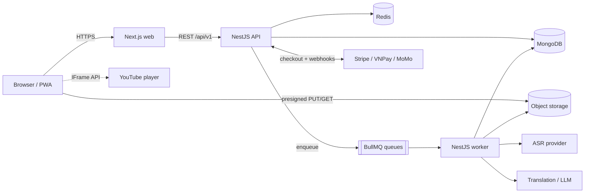

# Architecture - Lexiscene

> Last updated: 2026-10-10 | Status: draft | Vietnamese: [../vi/architecture.md](../vi/architecture.md)

## 1. System context



| Component | Responsibility |
|---|---|
| `apps/web` (Next.js, App Router) | UI, SEO for public video pages, i18n routing, player + transcript UI |
| `apps/api` (NestJS) | REST API, auth, business rules, entitlements, webhooks |
| `apps/worker` (NestJS standalone) | Transcription pipeline stages, shadowing scoring, emails; consumes BullMQ |
| MongoDB | Primary data store (replica set, needed for transactions) |
| Redis | Queues (BullMQ), cache (lookup), rate limiting |
| Object storage (S3-compatible) | User recordings, pipeline artifacts. Never third-party video files |
| Providers | ASR, translation/LLM, payments, email |

## 2. Repo layout

```
lexiscene/
  apps/
    api/        NestJS REST API
    worker/     NestJS standalone app (queues)
    web/        Next.js
  packages/
    shared/     zod schemas, DTO types, constants, text utils (normalize, diff, kana)
  docs/{en,vi}/
  .claude/
```

`packages/shared` is the single source of truth for request/response schemas and for **text normalization**, which the pipeline, dictation and shadowing scoring all reuse.

## 3. Backend modules (apps/api)

| Module | Notes |
|---|---|
| `auth` | Email/password, Google OAuth, JWT access + refresh rotation, email verification |
| `users` | Profile, locales, target languages |
| `videos` | Catalog, search, status lifecycle |
| `transcripts` | Read API, admin edit/publish |
| `dictionary` | Lookup, caching, batch lookup |
| `vocabulary` | Saved words, decks |
| `reviews` | SRS scheduling (FSRS), review logs |
| `dictation` | Sessions, attempts, diff/score |
| `shadowing` | Presigned upload, attempt lifecycle, score retrieval |
| `billing` | Plans, checkout, portal, subscriptions, entitlements, webhooks |
| `admin` | Pipeline control, reports, role guard |
| `common` | Config (zod-validated env), guards, pipes, filters (problem+json), logging |

Rules: thin controllers; services hold logic; repositories (Mongoose models) are only used by their own module's services; cross-module access through exported services.

## 4. Frontend structure (apps/web)

- App Router with locale segment: `app/[locale]/...`; `next-intl` for messages and routing.
- Server Components for public pages (video list/detail, SEO); Client Components for player, transcript, dictation, recorder.
- Server state: TanStack Query. Player state (current time, active segment, speed, loop): Zustand.
- API client generated from the OpenAPI document (e.g. `openapi-typescript`) so types never drift from the API.
- Japanese text rendered with `<ruby>` for furigana; web fonts with Japanese support (e.g. Noto Sans JP).
- Styling: Tailwind CSS + accessible primitives (e.g. shadcn/ui).

## 5. Key flows

**Lookup in transcript**
1. Transcript response already includes tokens with `entryId` (resolved by the pipeline).
2. Click a token -> `GET /dictionary/entries/:id` (Redis + HTTP cache, immutable-ish) -> popup.
3. "Save" -> `POST /vocabulary` with `{ entryId, sid, transcriptId, startMs, sentence }`.

**Dictation**
1. Start `POST /dictation/sessions` (checks entitlement).
2. For each segment, the player plays `[startMs, endMs]`; learner types; `POST .../attempts` with `{ sid, text }`.
3. API normalizes (shared utils), diffs against segment text, returns diff + score. Session summary on finish.

**Shadowing**
1. `POST /shadowing/attempts` -> returns presigned PUT URL.
2. Browser uploads the recording directly to object storage.
3. `POST .../complete` -> enqueue scoring job -> worker runs ASR -> compares to segment -> stores result.
4. Client polls `GET /shadowing/attempts/:id` (or SSE later).

**Payment**
1. `POST /billing/checkout-sessions` (with `Idempotency-Key`) -> provider checkout URL.
2. Provider calls webhook -> verify signature -> store event id (unique) -> update `subscriptions` + user entitlement snapshot in one transaction.
3. The client never grants itself access; it re-fetches `/billing/subscription`.

## 6. Internationalization

- UI: message files per locale (`messages/vi.json`, `messages/en.json`), routed by `[locale]`.
- Content: localized fields are maps `{ vi: "...", en: "..." }`. Resolve with fallback `nativeLocale -> en -> source`. API returns already-resolved strings plus the resolved locale.
- Locale codes are BCP-47 (`vi`, `en`, `ja`, later `ko`, `zh-Hans`...).
- New locale: add message file, enable in config, generate content translations lazily via the pipeline.

## 7. Authentication and authorization

- Access token: JWT, 15 min, sent as `Authorization: Bearer`, kept in memory in the browser.
- Refresh token: opaque, random, stored hashed server-side, httpOnly + Secure + SameSite cookie, rotated on every use with reuse detection (token family).
- Roles: `user`, `admin`. Entitlements (`plan`, limits) are checked in service layer through a `EntitlementsService`, not in controllers only.
- Rate limiting per IP and per user (`@nestjs/throttler` + Redis); stricter on auth and lookup-batch.

## 8. Payments design

- `PaymentProvider` interface (`createCheckout`, `createPortalSession`, `verifyWebhook`, `parseEvent`). Implementations: Stripe first; VNPay/MoMo later behind the same interface.
- Webhook endpoints take the raw body for signature verification, are idempotent (`webhook_events.eventId` unique), and return 2xx quickly (heavy work queued).
- Source of truth for access: `subscriptions` collection; user document keeps a denormalized `entitlement` snapshot for fast checks.

## 9. Caching and performance

- Dictionary entries: Redis cache + `Cache-Control` with ETag.
- Transcript: one document per video version; served with ETag; edge-cacheable for published content.
- Indexes per [database-design](./database-design.md).
- Pagination is cursor-based for all lists.

## 10. Environments and deployment (options)

- Local: Docker Compose for MongoDB (single-node replica set) and Redis; apps run with `pnpm dev`.
- Staging/Prod options: web on Vercel or container; API/worker as containers (Fly.io, Railway, Render, or a VPS); MongoDB Atlas; managed Redis; S3-compatible storage (S3 / Cloudflare R2). Choose via ADR when Phase 9 starts.
- Config: all via environment variables, validated at boot (fail fast).
- CI: lint, typecheck, test on every PR; build images on main.

## 11. Observability

- Structured JSON logs (pino) with `requestId`; never log tokens or PII.
- Error tracking (e.g. Sentry) for web, api, worker.
- Metrics: request latency, queue depth, job duration/failure, ASR cost per minute.
- Health: `GET /health` (liveness) and `/health/ready` (Mongo + Redis).

## 12. Testing strategy

| Level | Tooling | Focus |
|---|---|---|
| Unit | Jest / Vitest | Text utils (normalize, diff, kana), SRS, entitlements |
| Integration | Jest + Testcontainers or in-memory Mongo replica set | Repositories, webhooks, auth flows |
| E2E | Playwright | Watch -> lookup -> save; dictation; checkout (test mode) |
| Contract | OpenAPI diff in CI | Prevent accidental breaking API changes |

## 13. Decisions

See [adr/](./adr/). Initial: [0001 Monorepo and stack](./adr/0001-monorepo-and-stack.md).
