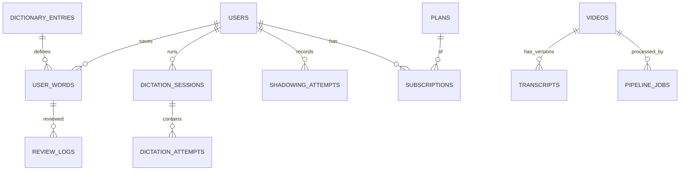

# Database Design - Lexiscene

> Last updated: 2026-10-10 | Status: draft | Vietnamese: [../vi/database-design.md](../vi/database-design.md)

## 1. Principles

- MongoDB 7+ with Mongoose, run as a **replica set** (needed for transactions, also locally).
- **Embed** data that is read together and is bounded (segments in a transcript). **Reference** otherwise.
- No unbounded arrays. Hard cap documented per array.
- Reference transcript segments by a stable `sid`, never by array index (editing/re-segmenting must not break saved words, attempts).
- All timestamps UTC `Date`; every collection has `createdAt`, `updatedAt`.
- Localized text = map `{ [locale]: string }` (see section 4).
- Every query used by an endpoint must be covered by an index; verify with `explain()` before shipping.

## 2. Entity overview



## 3. Collections

### users
| Field | Type | Notes |
|---|---|---|
| `email` | string | lowercase, unique |
| `passwordHash` | string? | argon2id; absent for OAuth-only |
| `providers[]` | `{ provider, providerId }` | max 5 |
| `emailVerifiedAt` | Date? | |
| `roles[]` | string[] | `user`, `admin` |
| `profile` | `{ displayName, uiLocale, nativeLocale, targetLangs: [{ lang, level }], dailyGoal }` | |
| `entitlement` | `{ tier, validUntil, limits }` | denormalized snapshot from subscriptions |
Indexes: `{ email: 1 }` unique; `{ 'providers.provider': 1, 'providers.providerId': 1 }` unique sparse.

### refresh_tokens
`userId, family, tokenHash, expiresAt, revokedAt?, userAgent, ip`. Indexes: `{ tokenHash: 1 }` unique; `{ userId: 1, family: 1 }`; TTL on `expiresAt`.

### videos
| Field | Type | Notes |
|---|---|---|
| `source` | `{ type: 'youtube'\|'upload'\|'podcast', ref }` | |
| `lang` | `'ja'\|'en'` | spoken language |
| `title`, `description` | locale map | |
| `durationSec`, `thumbnailUrl` | | |
| `level` | `{ system: 'JLPT'\|'CEFR', value }` | |
| `topics[]` | string[] | max 10 |
| `status` | `draft\|processing\|review\|published\|unpublished` | |
| `license` | `{ type, attribution, verifiedBy, verifiedAt }` | required before publish |
| `currentTranscriptId` | ObjectId? | |
| `publishedAt` | Date? | |
Indexes: `{ status: 1, lang: 1, 'level.value': 1, publishedAt: -1 }`; `{ 'source.type': 1, 'source.ref': 1 }` unique; text/Atlas Search on titles later.

### transcripts
One document per (video, version). Segments embedded (cap 1500 segments, ~2-3 MB; far below 16 MB).

```json
{
  "videoId": "...", "version": 3, "revision": 7, "lang": "ja", "status": "draft|published|archived",
  "origin": { "asr": "faster-whisper", "model": "large-v3", "pipelineJobId": "..." },
  "segments": [{
    "sid": "s_7Hk2", "idx": 0, "startMs": 1200, "endMs": 4300,
    "text": "今日は天気がいいですね。",
    "translations": { "vi": { "text": "Hôm nay thời tiết đẹp nhỉ.", "origin": "mt|human" }, "en": { "text": "...", "origin": "mt" } },
    "tokens": [{ "surface": "今日", "lemma": "今日", "reading": "きょう", "pos": "noun", "entryId": "...", "candidates": ["..."], "start": 0, "end": 2 }],
    "confidence": 0.94, "qaFlags": []
  }]
}
```
Indexes: `{ videoId: 1, version: -1 }` unique; `{ status: 1 }`. `revision` increments on each edit (optimistic locking). Published versions are edited in place only for fixes; re-processing creates a new `version`.

### dictionary_entries
| Field | Type | Notes |
|---|---|---|
| `lang` | `'ja'\|'en'` | |
| `headword`, `readings[]`, `forms[]` | | `forms` = all surface forms used for matching (conjugations for ja are handled by the tokenizer lemma, `forms` covers variants/kana spellings) |
| `pos[]` | string[] | normalized POS tags |
| `senses[]` | `{ pos, glosses: { [locale]: string[] }, examples: [{ text, translations }] }` | max 30 senses |
| `level` | `{ system, value }?` | JLPT / CEFR |
| `frequency` | number? | rank |
| `source` | `{ name, id, license }` | e.g. JMdict, Wiktionary |
Indexes: `{ lang: 1, headword: 1 }`; `{ lang: 1, forms: 1 }`; `{ 'source.name': 1, 'source.id': 1 }` unique.

### decks
`userId, lang, name, isDefault`. Index `{ userId: 1, lang: 1 }`.

### user_words (saved vocabulary + SRS state)
| Field | Type | Notes |
|---|---|---|
| `userId`, `lang`, `deckId` | | |
| `entryId` | ObjectId? | null if custom word |
| `lemma`, `surface`, `reading` | string | snapshot so the card survives dictionary updates |
| `context` | `{ sentence, videoId, transcriptId, sid, startMs }` | |
| `note`, `tags[]` | | tags max 20 |
| `srs` | `{ state, due, stability, difficulty, reps, lapses, lastReviewAt }` | FSRS fields |
Indexes: `{ userId: 1, lang: 1, lemma: 1, reading: 1 }` unique; `{ userId: 1, deckId: 1, 'srs.due': 1 }` (due queue).

### review_logs (append-only)
`userId, wordId, grade, prevState, newState, elapsedMs, reviewedAt`. Index `{ userId: 1, reviewedAt: -1 }`.

### dictation_sessions / dictation_attempts
- sessions: `userId, videoId, transcriptId, mode, fromSid, toSid, startedAt, finishedAt?, summary { score, attempts, accuracy }`. Index `{ userId: 1, startedAt: -1 }`.
- attempts: `sessionId, userId, sid, input, expectedSnapshot, diff[], score, durationMs, usedHints, createdAt`. Index `{ sessionId: 1, createdAt: 1 }`. Separate collection because the count is unbounded.

### shadowing_attempts
| Field | Type | Notes |
|---|---|---|
| `userId, videoId, sid` | | |
| `audio` | `{ key, mime, durationMs, sizeBytes }` | object storage key |
| `status` | `pending_upload\|uploaded\|scoring\|scored\|failed` | |
| `result` | `{ asrText, similarity, words: [{ expected, heard, ok }] }?` | |
| `expiresAt` | Date | retention (e.g. 30 days free / longer for Pro) |
Indexes: `{ userId: 1, videoId: 1, createdAt: -1 }`; TTL on `expiresAt` (a cleanup job also deletes the storage object).

### plans / subscriptions / payments / webhook_events
- `plans`: `code` (unique), `name` (locale map), `interval`, `prices[{ currency, amount, providerPriceIds }]`, `entitlements { dictationPerDay, shadowingScoring, ... }`, `active`.
- `subscriptions`: `userId, planCode, provider, providerSubscriptionId, status, currentPeriodEnd, cancelAtPeriodEnd`. Indexes: `{ userId: 1 }`; `{ provider: 1, providerSubscriptionId: 1 }` unique.
- `payments`: `userId, provider, providerPaymentId, amount, currency, status, paidAt`. Unique `{ provider, providerPaymentId }`. No card data.
- `webhook_events`: `provider, eventId, type, status, receivedAt, processedAt`. Unique `{ provider, eventId }`; TTL 90 days.

### pipeline_jobs
`videoId, transcriptVersion, stage, status, attempts, error?, startedAt, finishedAt, costEstimate, metrics`. Redis/BullMQ holds the live queue; this is the durable audit trail. Index `{ videoId: 1, createdAt: -1 }`, `{ status: 1 }`.

### reports
`userId, target { type, id, sid? }, reason, note, status, resolvedBy?`. Index `{ status: 1, createdAt: -1 }`.

## 4. i18n pattern

- Localized field: `{ "vi": "...", "en": "..." }`, keys are BCP-47 tags. Adding `ko` = adding keys, no migration.
- Resolution in the service layer: `value[nativeLocale] ?? value.en ?? value[source]`.
- Machine-generated text carries `origin: 'mt' | 'human'` so humans' edits are never overwritten by re-translation.
- Dictionary glosses are per-sense maps of string arrays.

## 5. Transactions and consistency

- Use transactions for: webhook handling (event + subscription + user entitlement), account deletion.
- Everything else is single-document atomic by design.
- Idempotency via unique indexes (`webhook_events`, `payments`, `user_words`).

## 6. Data lifecycle and privacy

- Shadowing audio: TTL + manual delete; storage object deleted by a cleanup job.
- Account deletion: remove PII, recordings, attempts; keep anonymized aggregates and payment records required by law.
- Backups: daily + PITR; restore drill before launch.

## 7. Migrations

Use a migration tool (e.g. `migrate-mongo`) with versioned scripts in `apps/api/migrations/`. Index creation is a migration, not `autoIndex` in production.
