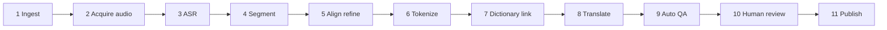
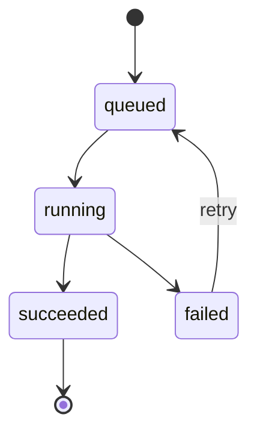

# Transcription Pipeline - Lexiscene

> Last updated: 2026-10-10 | Status: draft | Vietnamese: [../vi/transcription-pipeline.md](../vi/transcription-pipeline.md)

## 1. Purpose

Turn a video the platform is **allowed to process** into a published, token-level, translated transcript: segments with timings, tokens (surface, lemma, reading, POS), dictionary links, and translations per locale. Runs in `apps/worker` on BullMQ.

## 2. Stages

| # | Stage | What it does | Output |
|---|---|---|---|
| 1 | Ingest | Validate URL (SSRF-safe), fetch metadata (title, duration, thumbnail), require license record | `videos` draft |
| 2 | Acquire audio | Obtain audio through an allowed **source adapter** (see section 3); enforce max duration/size; temp storage | `audio.wav` (16 kHz mono) |
| 3 | ASR | Speech to text with word timestamps, VAD, language hint | `asr.json` (normalized) |
| 4 | Segment | Split into learner-friendly segments | draft segments |
| 5 | Align refine | If a human/creator transcript exists, forced-align it to audio and prefer its text | corrected timings/text |
| 6 | Tokenize | Language-specific tokenizer: surface, lemma, reading, POS, offsets | tokens per segment |
| 7 | Dictionary link | Match tokens to `dictionary_entries` | `entryId`, `candidates` |
| 8 | Translate | Translate each segment into target locales with context window and glossary | `translations[locale]` (`origin: mt`) |
| 9 | Auto QA | Compute flags and confidence | `qaFlags`, `confidence` |
| 10 | Human review | Admin editor: fix text/timing/tokens/translation | reviewed draft |
| 11 | Publish | Mark transcript `published`, set video `currentTranscriptId`, warm caches | published |

## 3. Source adapters (legal-safe by design)

The pipeline only processes audio we have rights to. Adapters implement `acquire(source): Promise<AudioFile>`:

| Adapter | Use | Notes |
|---|---|---|
| `upload` | Own or licensed content uploaded by admin | Full pipeline |
| `podcast-rss` | Podcasts whose license permits reuse | Verify license per feed |
| `captions-only` | Third-party video with creator-provided captions/transcript and explicit permission | Skip ASR; start at stage 4/5 with provided text; playback still via official embed |

Downloading audio/video from third-party platforms without permission is **not** supported (platform terms and copyright). Each video stores `license` and `verifiedBy` before publish.

## 4. Orchestration

- One BullMQ queue per stage group (`pipeline`, `translation`, `scoring`). Each stage is a job; a finished stage enqueues the next.
- Payload carries only ids: `{ videoId, transcriptVersion, stage }`. Data lives in Mongo and artifacts in object storage under `pipeline/{videoId}/{version}/`.
- **Idempotent stages**: job id = `${videoId}:${version}:${stage}`; rerun overwrites the same output.
- Retries: exponential backoff, max 3 for provider errors; permanent errors (invalid audio, license missing) fail fast.
- Timeouts per stage; concurrency limits (ASR is the expensive one).
- Every transition updates `pipeline_jobs` (durable audit) and video `status` (`processing` -> `review`).
- Admin can retry from any failed stage; "restart from stage N" reuses earlier artifacts.

## 5. Stage details

### 3. ASR
- Adapter interface: `transcribe(audioPath, { lang }) -> { segments: [{ startMs, endMs, text, words: [{ w, startMs, endMs, conf }] }] }`.
- Candidates: self-hosted `faster-whisper` (needs GPU, cheapest at scale) or a paid API (fastest to start). Decision per Open Question Q3 in requirements; record via ADR.
- Always normalize provider output into the contract above, so providers are swappable.

### 4. Segmentation rules
- Break on sentence punctuation (`。！？.!?`) and pauses > 600 ms.
- Target 2-6 s per segment; hard limits: 1-10 s.
- Japanese: max ~40 characters; English: max ~15 words. Split at clause boundaries; merge fragments shorter than 1 s into neighbors.
- Timings must be monotonic and non-overlapping.
- Each segment gets a stable `sid` (nanoid) at creation and keeps it forever.

### 6. Tokenization
| Language | Approach |
|---|---|
| ja | Morphological analyzer behind a `Tokenizer` interface. Start with a Node library (e.g. kuromoji-based) for speed of development; switch to Sudachi/Lindera via a small service if accuracy requires. Produce surface, lemma (dictionary form), reading (kana), POS, offsets |
| en | NLP lemmatizer (e.g. wink-nlp / compromise, or spaCy via service). Handle contractions, hyphenation; detect phrasal verbs/idioms in a later pass (P1) |

Reading for kanji is stored per token (furigana). Offsets are character offsets into the segment text.

### 7. Dictionary link
- Match by `(lang, lemma, reading?, pos)`; if several entries match, pick by POS fit then frequency, and keep the others in `candidates` for the admin to switch.
- Unmatched tokens get `entryId: null` and a QA flag when content words (not particles/punctuation).

### 8. Translation
- Translate segments in batches with surrounding context (previous/next segments) and a glossary of fixed terms.
- Provider: MT or LLM; output marked `origin: 'mt'`. Humans' edits get `origin: 'human'` and are never overwritten by re-translation.
- New locale later = run only this stage for existing transcripts (lazy or batch).
- Track cost per minute of video.

### 9. Auto QA flags
`LOW_CONFIDENCE`, `FAST_SPEECH` (chars or words per second too high), `LONG_SEGMENT`, `OVERLAP`, `EMPTY`, `UNMATCHED_TOKENS`, `NUMERIC_MISMATCH` (digits differ between source and translation), `MISSING_TRANSLATION`. The editor sorts/filters by flags so reviewers spend time where it matters.

## 6. Shared text utilities (`packages/shared`)

One implementation used by pipeline, dictation and shadowing scoring:
- `normalizeText(lang, text)`: Unicode NFKC, case folding, punctuation/whitespace rules, apostrophe variants.
- `toKana(text)` and kana normalization for Japanese comparison (hiragana/katakana unification, optional kanji-to-reading equivalence).
- `diffText(lang, expected, actual)`: word-level for English, character-level for Japanese.
- Tested with a fixture set (ja/en edge cases) to keep behavior stable.

## 7. Shadowing scoring (reuses the pipeline)

Recording uploaded -> `scoring` queue -> ASR adapter -> normalize both texts -> similarity (edit distance) + per-word hits/misses (Japanese compared on kana reading). Pitch accent / prosody is out of scope for v1.

## 8. Failure modes

| Failure | Handling |
|---|---|
| ASR hallucination in silence/music | VAD, drop segments below confidence, `LOW_CONFIDENCE` flag |
| Wrong tokenization (names, slang) | Admin edits tokens; optional user dictionary for the tokenizer |
| Provider outage / rate limit | Retry with backoff; keep stage state; alert after attempts exhausted |
| Very long video / big file | Reject at ingest (limits); chunk audio for ASR |
| Duplicate jobs | Deterministic job ids; unique `(source.type, source.ref)` |
| Cost spike | Per-job budget cap, daily budget alert |
| Poisoned URL (SSRF) | Allowlist schemes/hosts, resolve and block private IP ranges |

## 9. Observability and quality metrics

- Metrics: stage duration, failure rate, queue depth, ASR cost per video minute, translation cost per minute.
- Quality: sample WER on a gold set, token/dictionary coverage, reviewer edit rate and review minutes per video minute (target: shrink over time).
- Logs carry `videoId`, `version`, `stage`, `jobId`.

## 10. Security and cleanup

- Validate and limit input (duration, size, MIME). Process in a temp directory; delete audio after stage 3/5 unless retention is required.
- Provider keys only from environment; never log transcripts of private content at info level.

## 11. Future work

Speaker diarization, automatic level estimation (JLPT/CEFR), automatic topic tagging, pitch accent extraction, per-user custom dictionaries.
