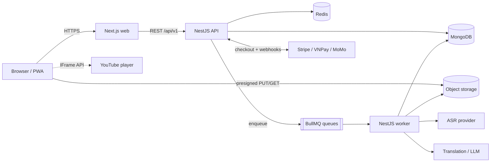

# Kiến trúc (Architecture) - Lexiscene

> Last updated: 2026-10-10 | Status: draft | English: [../en/architecture.md](../en/architecture.md)

## 1. Bối cảnh hệ thống



| Thành phần | Trách nhiệm |
|---|---|
| `apps/web` (Next.js, App Router) | UI, SEO cho trang video công khai, routing i18n, player + transcript UI |
| `apps/api` (NestJS) | REST API, auth, business rules, entitlement, webhook |
| `apps/worker` (NestJS standalone) | Các stage của pipeline transcript, chấm shadowing, gửi email; tiêu thụ BullMQ |
| MongoDB | Kho dữ liệu chính (replica set, cần cho transaction) |
| Redis | Queue (BullMQ), cache (tra từ), rate limiting |
| Object storage (tương thích S3) | Bản ghi âm người dùng, artifact của pipeline. Không bao giờ lưu file video bên thứ ba |
| Providers | ASR, dịch/LLM, thanh toán, email |

## 2. Cấu trúc repo

```
lexiscene/
  apps/
    api/        NestJS REST API
    worker/     NestJS standalone app (queues)
    web/        Next.js
  packages/
    shared/     zod schemas, DTO types, constants, text utils (normalize, diff, kana)
  docs/{en,vi}/
  .claude/
```

`packages/shared` là nguồn sự thật duy nhất cho schema request/response và cho **chuẩn hóa văn bản**, được pipeline, dictation và chấm shadowing dùng chung.

## 3. Các module backend (apps/api)

| Module | Ghi chú |
|---|---|
| `auth` | Email/mật khẩu, Google OAuth, JWT access + xoay vòng refresh, xác minh email |
| `users` | Hồ sơ, locale, ngôn ngữ đang học |
| `videos` | Danh mục, tìm kiếm, vòng đời trạng thái |
| `transcripts` | API đọc, admin sửa/xuất bản |
| `dictionary` | Tra từ, caching, tra hàng loạt |
| `vocabulary` | Từ đã lưu, deck |
| `reviews` | Lập lịch SRS (FSRS), review log |
| `dictation` | Phiên, lượt làm, diff/điểm |
| `shadowing` | Presigned upload, vòng đời attempt, lấy điểm |
| `billing` | Gói, checkout, portal, subscription, entitlement, webhook |
| `admin` | Điều khiển pipeline, báo lỗi, role guard |
| `common` | Config (env validate bằng zod), guard, pipe, filter (problem+json), logging |

Quy tắc: controller mỏng; service chứa logic; repository (Mongoose model) chỉ dùng trong service của module đó; truy cập chéo module qua service được export.

## 4. Cấu trúc frontend (apps/web)

- App Router với segment locale: `app/[locale]/...`; `next-intl` cho message và routing.
- Server Components cho trang công khai (danh sách/chi tiết video, SEO); Client Components cho player, transcript, dictation, recorder.
- Server state: TanStack Query. State của player (thời gian hiện tại, câu active, tốc độ, loop): Zustand.
- API client sinh từ tài liệu OpenAPI (vd. `openapi-typescript`) để type không bao giờ lệch khỏi API.
- Văn bản tiếng Nhật render bằng `<ruby>` cho furigana; web font hỗ trợ tiếng Nhật (vd. Noto Sans JP).
- Styling: Tailwind CSS + primitive accessible (vd. shadcn/ui).

## 5. Các luồng chính

**Tra từ trong transcript**
1. Response transcript đã gồm token kèm `entryId` (pipeline đã resolve).
2. Bấm token -> `GET /dictionary/entries/:id` (Redis + HTTP cache, gần như bất biến) -> popup.
3. "Lưu" -> `POST /vocabulary` với `{ entryId, sid, transcriptId, startMs, sentence }`.

**Dictation**
1. Bắt đầu `POST /dictation/sessions` (kiểm tra entitlement).
2. Với mỗi câu, player phát `[startMs, endMs]`; người học gõ; `POST .../attempts` với `{ sid, text }`.
3. API chuẩn hóa (shared utils), diff với text của câu, trả diff + điểm. Tổng kết phiên khi kết thúc.

**Shadowing**
1. `POST /shadowing/attempts` -> trả presigned PUT URL.
2. Browser upload thẳng bản ghi lên object storage.
3. `POST .../complete` -> đưa job chấm điểm vào queue -> worker chạy ASR -> so với câu -> lưu kết quả.
4. Client polling `GET /shadowing/attempts/:id` (SSE về sau).

**Thanh toán**
1. `POST /billing/checkout-sessions` (kèm `Idempotency-Key`) -> URL checkout của nhà cung cấp.
2. Nhà cung cấp gọi webhook -> xác minh chữ ký -> lưu event id (unique) -> cập nhật `subscriptions` + entitlement snapshot của user trong một transaction.
3. Client không bao giờ tự cấp quyền cho mình; nó gọi lại `/billing/subscription`.

## 6. Đa ngôn ngữ (i18n)

- UI: file message theo locale (`messages/vi.json`, `messages/en.json`), route theo `[locale]`.
- Nội dung: trường được localize là map `{ vi: "...", en: "..." }`. Resolve với dự phòng `nativeLocale -> en -> source`. API trả chuỗi đã resolve kèm locale đã dùng.
- Mã locale theo BCP-47 (`vi`, `en`, `ja`, sau này `ko`, `zh-Hans`...).
- Locale mới: thêm file message, bật trong config, sinh bản dịch nội dung theo kiểu lazy qua pipeline.

## 7. Xác thực và phân quyền

- Access token: JWT, 15 phút, gửi qua `Authorization: Bearer`, giữ trong bộ nhớ ở browser.
- Refresh token: opaque, ngẫu nhiên, lưu dạng băm phía server, cookie httpOnly + Secure + SameSite, xoay vòng mỗi lần dùng kèm phát hiện tái sử dụng (token family).
- Vai trò: `user`, `admin`. Entitlement (`plan`, giới hạn) kiểm tra ở tầng service qua `EntitlementsService`, không chỉ ở controller.
- Rate limiting theo IP và theo user (`@nestjs/throttler` + Redis); chặt hơn cho auth và lookup-batch.

## 8. Thiết kế thanh toán

- Interface `PaymentProvider` (`createCheckout`, `createPortalSession`, `verifyWebhook`, `parseEvent`). Triển khai Stripe trước; VNPay/MoMo sau, cùng interface.
- Endpoint webhook nhận raw body để xác minh chữ ký, idempotent (`webhook_events.eventId` unique), trả 2xx nhanh (việc nặng đưa vào queue).
- Nguồn sự thật cho quyền truy cập: collection `subscriptions`; document user giữ snapshot `entitlement` phi chuẩn hóa để kiểm tra nhanh.

## 9. Caching và hiệu năng

- Dictionary entry: cache Redis + `Cache-Control` với ETag.
- Transcript: một document cho mỗi version của video; trả kèm ETag; nội dung đã publish có thể cache ở edge.
- Index theo [database-design](./database-design.md).
- Mọi danh sách dùng cursor pagination.

## 10. Môi trường và triển khai (các lựa chọn)

- Local: Docker Compose cho MongoDB (replica set một node) và Redis; các app chạy bằng `pnpm dev`.
- Staging/Prod: web trên Vercel hoặc container; API/worker dạng container (Fly.io, Railway, Render hoặc VPS); MongoDB Atlas; Redis managed; storage tương thích S3 (S3 / Cloudflare R2). Chọn qua ADR khi bắt đầu Phase 9.
- Config: toàn bộ qua biến môi trường, validate khi khởi động (fail fast).
- CI: lint, typecheck, test trên mỗi PR; build image trên main.

## 11. Quan sát hệ thống (Observability)

- Log JSON có cấu trúc (pino) kèm `requestId`; không log token hay PII.
- Theo dõi lỗi (vd. Sentry) cho web, api, worker.
- Metrics: độ trễ request, độ sâu queue, thời lượng/tỉ lệ lỗi job, chi phí ASR theo phút.
- Health: `GET /health` (liveness) và `/health/ready` (Mongo + Redis).

## 12. Chiến lược kiểm thử

| Mức | Công cụ | Trọng tâm |
|---|---|---|
| Unit | Jest / Vitest | Text utils (normalize, diff, kana), SRS, entitlement |
| Integration | Jest + Testcontainers hoặc Mongo replica set in-memory | Repository, webhook, luồng auth |
| E2E | Playwright | Xem -> tra -> lưu; dictation; checkout (test mode) |
| Contract | So sánh OpenAPI trong CI | Chống thay đổi API gây vỡ ngoài ý muốn |

## 13. Quyết định

Xem [adr/](./adr/). Ban đầu: [0001 Monorepo và stack](./adr/0001-monorepo-and-stack.md).
