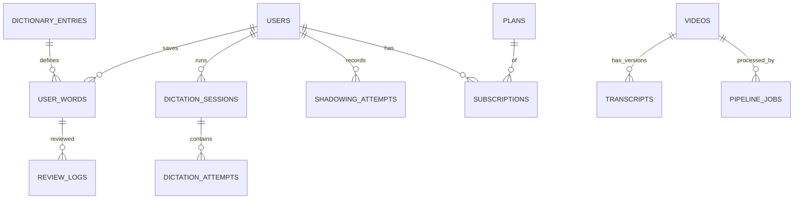

# Thiết kế cơ sở dữ liệu (Database Design) - Lexiscene

> Last updated: 2026-10-10 | Status: draft | English: [../en/database-design.md](../en/database-design.md)

## 1. Nguyên tắc

- MongoDB 7+ với Mongoose, chạy dạng **replica set** (cần cho transaction, cả ở local).
- **Embed** dữ liệu được đọc cùng nhau và có giới hạn (segment trong transcript). Còn lại thì **reference**.
- Không dùng mảng không giới hạn. Mỗi mảng có hạn mức cứng được ghi rõ.
- Tham chiếu segment của transcript bằng `sid` ổn định, không bao giờ bằng chỉ số mảng (sửa/chia lại segment không được làm hỏng từ đã lưu, attempt).
- Mọi timestamp là `Date` UTC; mọi collection có `createdAt`, `updatedAt`.
- Văn bản localize = map `{ [locale]: string }` (xem mục 4).
- Mọi truy vấn của endpoint phải có index phủ; kiểm tra bằng `explain()` trước khi ship.

## 2. Tổng quan thực thể



## 3. Các collection

### users
| Trường | Kiểu | Ghi chú |
|---|---|---|
| `email` | string | chữ thường, unique |
| `passwordHash` | string? | argon2id; không có nếu chỉ dùng OAuth |
| `providers[]` | `{ provider, providerId }` | tối đa 5 |
| `emailVerifiedAt` | Date? | |
| `roles[]` | string[] | `user`, `admin` |
| `profile` | `{ displayName, uiLocale, nativeLocale, targetLangs: [{ lang, level }], dailyGoal }` | |
| `entitlement` | `{ tier, validUntil, limits }` | snapshot phi chuẩn hóa từ subscriptions |
Index: `{ email: 1 }` unique; `{ 'providers.provider': 1, 'providers.providerId': 1 }` unique sparse.

### refresh_tokens
`userId, family, tokenHash, expiresAt, revokedAt?, userAgent, ip`. Index: `{ tokenHash: 1 }` unique; `{ userId: 1, family: 1 }`; TTL trên `expiresAt`.

### videos
| Trường | Kiểu | Ghi chú |
|---|---|---|
| `source` | `{ type: 'youtube'\|'upload'\|'podcast', ref }` | |
| `lang` | `'ja'\|'en'` | ngôn ngữ được nói |
| `title`, `description` | locale map | |
| `durationSec`, `thumbnailUrl` | | |
| `level` | `{ system: 'JLPT'\|'CEFR', value }` | |
| `topics[]` | string[] | tối đa 10 |
| `status` | `draft\|processing\|review\|published\|unpublished` | |
| `license` | `{ type, attribution, verifiedBy, verifiedAt }` | bắt buộc trước khi publish |
| `currentTranscriptId` | ObjectId? | |
| `publishedAt` | Date? | |
Index: `{ status: 1, lang: 1, 'level.value': 1, publishedAt: -1 }`; `{ 'source.type': 1, 'source.ref': 1 }` unique; text/Atlas Search cho tiêu đề về sau.

### transcripts
Một document cho mỗi (video, version). Segment được embed (tối đa 1500 segment, ~2-3 MB; thấp hơn nhiều so với 16 MB).

```json
{
  "videoId": "...", "version": 3, "revision": 7, "lang": "ja", "status": "draft|published|archived",
  "origin": { "asr": "faster-whisper", "model": "large-v3", "pipelineJobId": "..." },
  "segments": [{
    "sid": "s_7Hk2", "idx": 0, "startMs": 1200, "endMs": 4300,
    "text": "今日は天気がいいですね。",
    "translations": { "vi": { "text": "Hôm nay thời tiết đẹp nhỉ.", "origin": "mt|human" }, "en": { "text": "...", "origin": "mt" } },
    "tokens": [{ "surface": "今日", "lemma": "今日", "reading": "きょう", "pos": "noun", "entryId": "...", "candidates": ["..."], "start": 0, "end": 2 }],
    "confidence": 0.94, "qaFlags": []
  }]
}
```
Index: `{ videoId: 1, version: -1 }` unique; `{ status: 1 }`. `revision` tăng mỗi lần sửa (optimistic locking). Version đã publish chỉ được sửa tại chỗ để chữa lỗi; xử lý lại sẽ tạo `version` mới.

### dictionary_entries
| Trường | Kiểu | Ghi chú |
|---|---|---|
| `lang` | `'ja'\|'en'` | |
| `headword`, `readings[]`, `forms[]` | | `forms` = mọi dạng bề mặt dùng để match (chia động từ tiếng Nhật do lemma của tokenizer lo; `forms` phủ biến thể/cách viết kana) |
| `pos[]` | string[] | tag từ loại đã chuẩn hóa |
| `senses[]` | `{ pos, glosses: { [locale]: string[] }, examples: [{ text, translations }] }` | tối đa 30 sense |
| `level` | `{ system, value }?` | JLPT / CEFR |
| `frequency` | number? | thứ hạng |
| `source` | `{ name, id, license }` | vd. JMdict, Wiktionary |
Index: `{ lang: 1, headword: 1 }`; `{ lang: 1, forms: 1 }`; `{ 'source.name': 1, 'source.id': 1 }` unique.

### decks
`userId, lang, name, isDefault`. Index `{ userId: 1, lang: 1 }`.

### user_words (từ vựng đã lưu + trạng thái SRS)
| Trường | Kiểu | Ghi chú |
|---|---|---|
| `userId`, `lang`, `deckId` | | |
| `entryId` | ObjectId? | null nếu là từ tự thêm |
| `lemma`, `surface`, `reading` | string | snapshot để thẻ sống sót khi từ điển cập nhật |
| `context` | `{ sentence, videoId, transcriptId, sid, startMs }` | |
| `note`, `tags[]` | | tag tối đa 20 |
| `srs` | `{ state, due, stability, difficulty, reps, lapses, lastReviewAt }` | trường FSRS |
Index: `{ userId: 1, lang: 1, lemma: 1, reading: 1 }` unique; `{ userId: 1, deckId: 1, 'srs.due': 1 }` (hàng đợi đến hạn).

### review_logs (chỉ ghi thêm)
`userId, wordId, grade, prevState, newState, elapsedMs, reviewedAt`. Index `{ userId: 1, reviewedAt: -1 }`.

### dictation_sessions / dictation_attempts
- sessions: `userId, videoId, transcriptId, mode, fromSid, toSid, startedAt, finishedAt?, summary { score, attempts, accuracy }`. Index `{ userId: 1, startedAt: -1 }`.
- attempts: `sessionId, userId, sid, input, expectedSnapshot, diff[], score, durationMs, usedHints, createdAt`. Index `{ sessionId: 1, createdAt: 1 }`. Tách collection vì số lượng không giới hạn.

### shadowing_attempts
| Trường | Kiểu | Ghi chú |
|---|---|---|
| `userId, videoId, sid` | | |
| `audio` | `{ key, mime, durationMs, sizeBytes }` | key trong object storage |
| `status` | `pending_upload\|uploaded\|scoring\|scored\|failed` | |
| `result` | `{ asrText, similarity, words: [{ expected, heard, ok }] }?` | |
| `expiresAt` | Date | thời hạn lưu (vd. 30 ngày Free / dài hơn cho Pro) |
Index: `{ userId: 1, videoId: 1, createdAt: -1 }`; TTL trên `expiresAt` (job dọn dẹp cũng xóa object trong storage).

### plans / subscriptions / payments / webhook_events
- `plans`: `code` (unique), `name` (locale map), `interval`, `prices[{ currency, amount, providerPriceIds }]`, `entitlements { dictationPerDay, shadowingScoring, ... }`, `active`.
- `subscriptions`: `userId, planCode, provider, providerSubscriptionId, status, currentPeriodEnd, cancelAtPeriodEnd`. Index: `{ userId: 1 }`; `{ provider: 1, providerSubscriptionId: 1 }` unique.
- `payments`: `userId, provider, providerPaymentId, amount, currency, status, paidAt`. Unique `{ provider, providerPaymentId }`. Không lưu dữ liệu thẻ.
- `webhook_events`: `provider, eventId, type, status, receivedAt, processedAt`. Unique `{ provider, eventId }`; TTL 90 ngày.

### pipeline_jobs
`videoId, transcriptVersion, stage, status, attempts, error?, startedAt, finishedAt, costEstimate, metrics`. Redis/BullMQ giữ queue đang chạy; collection này là nhật ký bền vững. Index `{ videoId: 1, createdAt: -1 }`, `{ status: 1 }`.

### reports
`userId, target { type, id, sid? }, reason, note, status, resolvedBy?`. Index `{ status: 1, createdAt: -1 }`.

## 4. i18n pattern

- Trường localize: `{ "vi": "...", "en": "..." }`, key là tag BCP-47. Thêm `ko` = thêm key, không cần migration.
- Resolve ở tầng service: `value[nativeLocale] ?? value.en ?? value[source]`.
- Văn bản máy sinh mang `origin: 'mt' | 'human'` để chỉnh sửa của con người không bao giờ bị dịch lại ghi đè.
- Nghĩa trong từ điển là map theo từng sense, giá trị là mảng chuỗi.

## 5. Transaction và tính nhất quán

- Dùng transaction cho: xử lý webhook (event + subscription + entitlement của user), xóa tài khoản.
- Mọi thứ khác được thiết kế để atomic ở mức một document.
- Idempotency nhờ unique index (`webhook_events`, `payments`, `user_words`).

## 6. Vòng đời dữ liệu và quyền riêng tư

- Audio shadowing: TTL + xóa thủ công; object trong storage bị job dọn dẹp xóa.
- Xóa tài khoản: xóa PII, bản ghi âm, attempt; giữ số liệu tổng hợp ẩn danh và bản ghi thanh toán theo yêu cầu pháp luật.
- Backup: hằng ngày + PITR; diễn tập khôi phục trước khi ra mắt.

## 7. Migration

Dùng công cụ migration (vd. `migrate-mongo`) với script có version trong `apps/api/migrations/`. Tạo index là một migration, không dùng `autoIndex` ở production.
