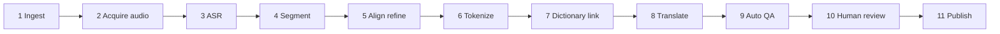
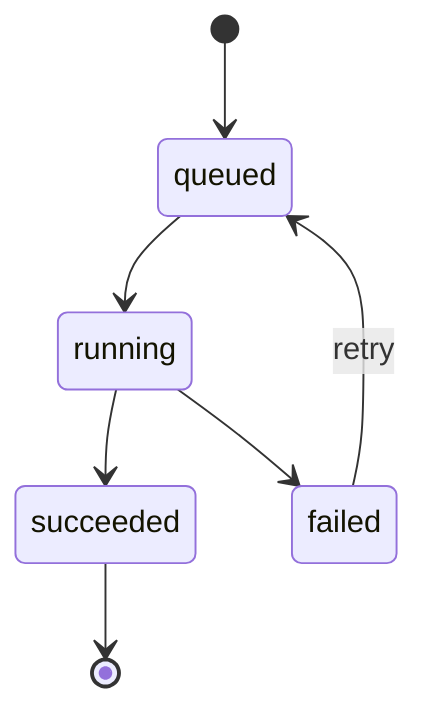

# Pipeline tạo transcript (Transcription Pipeline) - Lexiscene

> Last updated: 2026-10-10 | Status: draft | English: [../en/transcription-pipeline.md](../en/transcription-pipeline.md)

## 1. Mục đích

Biến một video mà nền tảng **được phép xử lý** thành transcript đã xuất bản, có token, có bản dịch: các segment kèm thời gian, token (surface, lemma, cách đọc, từ loại), liên kết từ điển và bản dịch theo từng locale. Chạy trong `apps/worker` trên BullMQ.

## 2. Các stage

| # | Stage | Làm gì | Đầu ra |
|---|---|---|---|
| 1 | Ingest | Validate URL (chống SSRF), lấy metadata (tiêu đề, thời lượng, thumbnail), bắt buộc có bản ghi license | `videos` draft |
| 2 | Acquire audio | Lấy audio qua một **source adapter** được phép (xem mục 3); giới hạn thời lượng/dung lượng; lưu tạm | `audio.wav` (16 kHz mono) |
| 3 | ASR | Speech to text kèm timestamp theo từ, VAD, gợi ý ngôn ngữ | `asr.json` (đã chuẩn hóa) |
| 4 | Segment | Chia thành các segment thân thiện với người học | segment nháp |
| 5 | Align refine | Nếu có transcript của con người/tác giả, forced-align vào audio và ưu tiên văn bản đó | thời gian/văn bản đã sửa |
| 6 | Tokenize | Tokenizer theo ngôn ngữ: surface, lemma, cách đọc, từ loại, offset | token cho mỗi segment |
| 7 | Dictionary link | Khớp token với `dictionary_entries` | `entryId`, `candidates` |
| 8 | Translate | Dịch từng segment sang các locale đích với cửa sổ ngữ cảnh và glossary | `translations[locale]` (`origin: mt`) |
| 9 | Auto QA | Tính cờ cảnh báo và độ tin cậy | `qaFlags`, `confidence` |
| 10 | Human review | Trình sửa của admin: chỉnh văn bản/thời gian/token/bản dịch | bản nháp đã duyệt |
| 11 | Publish | Đánh dấu transcript `published`, đặt `currentTranscriptId` của video, làm nóng cache | đã xuất bản |

## 3. Source adapter (an toàn pháp lý ngay từ thiết kế)

Pipeline chỉ xử lý audio mà chúng ta có quyền. Adapter hiện thực `acquire(source): Promise<AudioFile>`:

| Adapter | Dùng cho | Ghi chú |
|---|---|---|
| `upload` | Nội dung của mình hoặc được cấp phép do admin upload | Chạy đủ pipeline |
| `podcast-rss` | Podcast có giấy phép cho phép tái sử dụng | Kiểm tra license từng feed |
| `captions-only` | Video bên thứ ba có caption/transcript do tác giả cung cấp và được cho phép rõ ràng | Bỏ qua ASR; bắt đầu từ stage 4/5 với văn bản có sẵn; phát video vẫn qua embed chính thức |

**Không** hỗ trợ tải audio/video từ nền tảng bên thứ ba khi chưa được phép (điều khoản nền tảng và bản quyền). Mỗi video lưu `license` và `verifiedBy` trước khi publish.

## 4. Điều phối (Orchestration)

- Mỗi nhóm stage một queue BullMQ (`pipeline`, `translation`, `scoring`). Mỗi stage là một job; stage xong thì đưa stage kế vào queue.
- Payload chỉ mang id: `{ videoId, transcriptVersion, stage }`. Dữ liệu nằm trong Mongo, artifact trong object storage tại `pipeline/{videoId}/{version}/`.
- **Stage idempotent**: job id = `${videoId}:${version}:${stage}`; chạy lại ghi đè cùng một đầu ra.
- Retry: exponential backoff, tối đa 3 lần với lỗi nhà cung cấp; lỗi vĩnh viễn (audio hỏng, thiếu license) fail ngay.
- Timeout theo stage; giới hạn concurrency (ASR là stage đắt nhất).
- Mỗi lần chuyển trạng thái cập nhật `pipeline_jobs` (nhật ký bền vững) và `status` của video (`processing` -> `review`).
- Admin có thể retry từ bất kỳ stage lỗi nào; "chạy lại từ stage N" tái sử dụng artifact trước đó.

## 5. Chi tiết các stage

### 3. ASR
- Interface adapter: `transcribe(audioPath, { lang }) -> { segments: [{ startMs, endMs, text, words: [{ w, startMs, endMs, conf }] }] }`.
- Ứng viên: `faster-whisper` tự host (cần GPU, rẻ nhất khi quy mô lớn) hoặc API trả phí (nhanh nhất để bắt đầu). Quyết định theo Câu hỏi mở Q3 trong requirements; ghi lại bằng ADR.
- Luôn chuẩn hóa đầu ra của nhà cung cấp về contract trên để có thể đổi provider.

### 4. Quy tắc chia segment
- Cắt ở dấu câu kết câu (`。！？.!?`) và khoảng lặng > 600 ms.
- Mục tiêu 2-6 s mỗi segment; giới hạn cứng: 1-10 s.
- Tiếng Nhật: tối đa ~40 ký tự; tiếng Anh: tối đa ~15 từ. Cắt ở ranh giới mệnh đề; gộp mảnh ngắn hơn 1 s vào segment bên cạnh.
- Thời gian phải tăng dần và không chồng lấn.
- Mỗi segment nhận một `sid` ổn định (nanoid) khi tạo và giữ mãi.

### 6. Tokenization
| Ngôn ngữ | Cách làm |
|---|---|
| ja | Bộ phân tích hình thái đặt sau interface `Tokenizer`. Bắt đầu bằng thư viện Node (vd. dựa trên kuromoji) để phát triển nhanh; chuyển sang Sudachi/Lindera qua một service nhỏ nếu cần độ chính xác. Sinh surface, lemma (dạng từ điển), cách đọc (kana), từ loại, offset |
| en | Lemmatizer NLP (vd. wink-nlp / compromise, hoặc spaCy qua service). Xử lý dạng rút gọn, gạch nối; nhận diện cụm động từ/thành ngữ ở lượt sau (P1) |

Cách đọc của kanji lưu theo từng token (furigana). Offset là offset ký tự trong văn bản segment.

### 7. Liên kết từ điển
- Khớp theo `(lang, lemma, reading?, pos)`; nếu nhiều entry khớp, chọn theo độ hợp từ loại rồi tần suất, giữ các entry còn lại trong `candidates` để admin đổi.
- Token không khớp có `entryId: null` và gắn cờ QA nếu là từ nội dung (không phải trợ từ/dấu câu).

### 8. Dịch
- Dịch segment theo lô với ngữ cảnh xung quanh (segment trước/sau) và glossary thuật ngữ cố định.
- Nhà cung cấp: MT hoặc LLM; đầu ra đánh dấu `origin: 'mt'`. Chỉnh sửa của con người mang `origin: 'human'` và không bao giờ bị dịch lại ghi đè.
- Locale mới sau này = chỉ chạy stage này cho transcript hiện có (lazy hoặc theo lô).
- Theo dõi chi phí theo phút video.

### 9. Cờ Auto QA
`LOW_CONFIDENCE`, `FAST_SPEECH` (số ký tự hoặc từ mỗi giây quá cao), `LONG_SEGMENT`, `OVERLAP`, `EMPTY`, `UNMATCHED_TOKENS`, `NUMERIC_MISMATCH` (chữ số khác nhau giữa bản gốc và bản dịch), `MISSING_TRANSLATION`. Trình sửa cho phép sắp xếp/lọc theo cờ để người duyệt dồn thời gian vào chỗ quan trọng.

## 6. Text utilities dùng chung (`packages/shared`)

Một bản hiện thực dùng cho pipeline, dictation và chấm shadowing:
- `normalizeText(lang, text)`: Unicode NFKC, case folding, quy tắc dấu câu/khoảng trắng, các biến thể dấu nháy.
- `toKana(text)` và chuẩn hóa kana để so sánh tiếng Nhật (thống nhất hiragana/katakana, tùy chọn coi kanji tương đương cách đọc).
- `diffText(lang, expected, actual)`: theo từ cho tiếng Anh, theo ký tự cho tiếng Nhật.
- Có bộ fixture test (các trường hợp biên ja/en) để hành vi ổn định.

## 7. Chấm shadowing (tái sử dụng pipeline)

Bản ghi upload xong -> queue `scoring` -> ASR adapter -> chuẩn hóa cả hai văn bản -> độ tương đồng (edit distance) + từ đúng/sót (tiếng Nhật so sánh theo cách đọc kana). Pitch accent / prosody ngoài phạm vi v1.

## 8. Các kiểu lỗi (Failure modes)

| Lỗi | Cách xử lý |
|---|---|
| ASR bịa chữ ở đoạn im lặng/nhạc | VAD, loại segment dưới ngưỡng tin cậy, cờ `LOW_CONFIDENCE` |
| Tokenize sai (tên riêng, tiếng lóng) | Admin sửa token; tùy chọn từ điển người dùng cho tokenizer |
| Nhà cung cấp lỗi / bị giới hạn | Retry với backoff; giữ trạng thái stage; cảnh báo khi hết lượt thử |
| Video rất dài / file lớn | Từ chối ở ingest (giới hạn); chia nhỏ audio cho ASR |
| Job trùng | Job id xác định; unique `(source.type, source.ref)` |
| Chi phí tăng vọt | Trần ngân sách mỗi job, cảnh báo ngân sách hằng ngày |
| URL độc hại (SSRF) | Allowlist scheme/host, resolve và chặn dải IP nội bộ |

## 9. Quan sát và chỉ số chất lượng

- Metrics: thời lượng stage, tỉ lệ lỗi, độ sâu queue, chi phí ASR theo phút video, chi phí dịch theo phút.
- Chất lượng: WER mẫu trên bộ gold, độ phủ token/từ điển, tỉ lệ sửa của người duyệt và số phút duyệt trên mỗi phút video (mục tiêu: giảm dần).
- Log mang `videoId`, `version`, `stage`, `jobId`.

## 10. Bảo mật và dọn dẹp

- Validate và giới hạn đầu vào (thời lượng, dung lượng, MIME). Xử lý trong thư mục tạm; xóa audio sau stage 3/5 trừ khi cần lưu giữ.
- Key nhà cung cấp chỉ lấy từ biến môi trường; không log transcript của nội dung riêng tư ở mức info.

## 11. Công việc tương lai

Phân biệt người nói (diarization), tự ước lượng trình độ (JLPT/CEFR), tự gắn chủ đề, trích xuất pitch accent, từ điển riêng cho từng người dùng.
